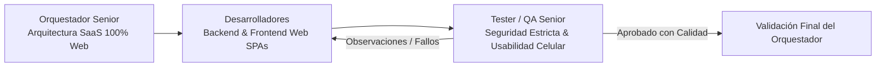

# Misión y Visión del Sistema SaaS - Chifa Mariana & Red Restaurantera

## 1. Declaración de Misión
Desarrollar una plataforma **SaaS Multi-Tenancy (Multinquilino) 100% Web**, accesible desde cualquier navegador (PC, pantallas táctiles de cocina, tablets y teléfonos celulares de las meseras), para la gestión integral de restaurantes (iniciando con **Chifa Mariana** y expandible a múltiples empresas gastronómicas), garantizando aislamiento absoluto de datos entre inquilinos y sincronización en tiempo real entre salón, cocinas dinámicas y caja.

El sistema se distingue por una interfaz táctil de élite diseñada bajo el sistema **Executive Precision Dark** y los principios de microinteracciones de **Emil Kowalski**, con arquitectura reactiva basada en **Redux Toolkit (RTK)**, autenticación con **Better Auth**, gestión de secretos en **OpenBao**, escaneo continuo con **Gitleaks**, políticas de **Seguridad Estricta** y un protocolo de **Aprendizaje Continuo de Errores** optimizado para un uso eficiente de tokens.

---

## 2. Alcance del Sistema y Reglas de Negocio Centrales

### 2.1. Arquitectura SaaS Multi-Tenancy (100% Web)
- **Acceso Universal Web**: No existen aplicaciones móviles nativas; todos los roles (administradores, cajeros, cocineros y meseras desde sus celulares) acceden mediante la plataforma web responsive.
- **Aislamiento por Tenant**: Cada empresa/restaurante opera como un `tenant` independiente (`tenant_id`). Todas las entidades pertenecen a un tenant.
- **Jerarquía de Roles SaaS**:
  - `SUPER_ADMIN`: Administrador de la plataforma SaaS (gestión de empresas inquilinas, suscripciones y métricas globales).
  - `ADMIN` (Tenant Admin): Administrador del restaurante. Único usuario autorizado para crear trabajadores de su local, configurar la carta, definir pantallas KDS y auditar ventas.
  - `CAJERO`: Operación de cobro, apertura y cierre de turno asignado, arqueo.
  - `MESERA`: Toma de pedidos en mesas o para llevar desde celulares/tablets vía web (condicionada a turno abierto).
  - `COCINERO`: Visualización y despacho en la(s) pantalla(s) KDS asignadas en monitores o tablets.

### 2.2. Gestión de Turnos y Ciclo de Vida de Sesión Atado al Turno (Shift-Bound Sessions)
- **Apertura Obligatoria de Turno**: Ninguna mesera ni terminal web puede emitir pedidos sin que exista un turno abierto formalmente por el Administrador o Cajero con su fondo inicial en caja.
- **Regla de Sesión Persistente y Cierre Condicional**:
  - **Mientras el turno esté ABIERTO (`status = 'OPEN'`)**: Las sesiones web de todo el personal (cajeros, meseras en celulares, cocineros en KDS, administradores) **se mantienen activas de forma indefinida** mediante renovación automática (keep-alive) en Better Auth. Ningún trabajador sufrirá cierre de sesión involuntario durante el servicio.
  - **Expiración tras Cierre de Turno (`status = 'CLOSED'`)**: La sesión **únicamente** se cerrará si el turno fue cerrado formalmente y han transcurrido entre **2 a 3 horas** desde la hora exacta del cierre (`closed_at`). Esta ventana de gracia permite finalizar arqueos, limpieza y revisiones. Cumplido este lapso, el sistema invalida y revoca automáticamente las sesiones de todos los empleados del tenant, obligando a un nuevo login para la siguiente jornada.

### 2.3. Pantallas KDS Dinámicas y Enrutamiento Configurable por el Usuario
- **Creación de Pantallas por el Administrador**: El Administrador del restaurante crea y administra libremente sus pantallas/estaciones de cocina (ej. *Pantalla 1 - Wok y Caldos*, *Pantalla 2 - Broaster y Hamburguesas*, *Pantalla 3 - Bar y Bebidas*, *Pantalla N...*).
- **Enrutamiento de Ítems de la Carta**: Al crear o editar un plato o categoría en la carta, el usuario escoge a qué pantalla KDS específica se enviará cada producto.
- **Regla Inmutable de Despacho a Caja**: **Todo pedido sin excepción se envía siempre a Caja** para control de cuenta y cobranza, simultáneamente con su distribución a las pantallas KDS configuradas.

### 2.4. Experiencia de Usuario y Diseño: Executive Precision Dark (Mobile Web & Desktop)
- **Diseño Visual**: Paleta corporativa oscura de alta precisión: Canvas `#0B0F17`, Cards `#131823`, Primary `#2563EB`, Secondary `#10B981`, Tertiary `#D97706`, Neutral `#757681`.
- **Adaptabilidad Táctil en Celulares**: Botones de tamaño mínimo táctil (48px), disposición a una sola mano para meseras en celulares y cero necesidad de zoom.
- **Tipografía Rigurosa**: `Inter` para títulos y lectura; `JetBrains Mono` mandatorio para precios (`S/ 28.00`), cronómetros de cocina y códigos de comanda.
- **Principios de Emil Kowalski**: Animaciones spring fluidas (`scale(0.97)` en toques táctiles), transiciones suaves sin layout shift (CLS = 0) y notificaciones no intrusivas con Sonner.
- **Redux Toolkit (RTK)**: Gestión de estado global atómico para carritos, turnos y eventos KDS en tiempo real.

### 2.5. Seguridad Estricta, Protección de BD y Secretos
- **Regla Anti-Eliminación de BD (Zero Data Loss)**:
  - Prohibición de `DROP DATABASE`, `DROP TABLE`, `TRUNCATE` y `DELETE` físico.
  - Usuario de base de datos MySQL con **Principio de Menor Privilegio (PoLP)**: únicamente permisos `SELECT`, `INSERT`, `UPDATE` y `EXECUTE`.
  - Borrado lógico transversal (*Soft Delete*) mediante `deleted_at`.
  - TypeORM con `synchronize: false` permanente.
- **Autenticación con Better Auth**: Manejo nativo de sesiones web, RBAC, plugin de organizaciones para multi-tenancy y protección contra ataques de fuerza bruta y *timing attacks*.
- **Gestión de Secretos con OpenBao**: Prohibición de `.env` planos con credenciales de producción. Inyección en memoria en tiempo de arranque.
- **Auditoría de Código con Gitleaks**: Escaneo en pre-commit hooks y pipelines de CI/CD para impedir fugas de credenciales.
- **Memoria de Aprendizaje Eficiente**: Registro compacto en `Spec/memory/error-log.md` para consolidar lecciones aprendidas sin desperdicio de tokens de contexto.

---

## 3. Equipo de Trabajo y Metodología (Loop de Rectificación)

### Roles del Equipo:
1. **Orquestador Senior (SaaS Architect & Security Lead)**: Vela por el aislamiento estricto multi-inquilino, el modelo de datos, la integración de Better Auth y OpenBao, y aprueba cada entrega.
2. **Desarrollador Backend (NestJS, Better Auth & MySQL)**: Construye los módulos del Monolito Modular, aislamiento con `tenant_id`, WebSockets y el motor de eventos.
3. **Desarrollador Frontend Web (Next.js SPAs con RTK, Mobile Web & Executive Precision Dark)**: Desarrolla las interfaces táctiles desacopladas (Caja, KDS dinámicas 1..N, Comandero optimizado para celulares de meseras) aplicando los principios de Emil Kowalski.
4. **Tester / QA Senior**: Diseña suites de pruebas para fuga de datos entre tenants, pruebas de fuerza bruta, persistencia de sesión ligada al turno y despacho a pantallas dinámicas.
