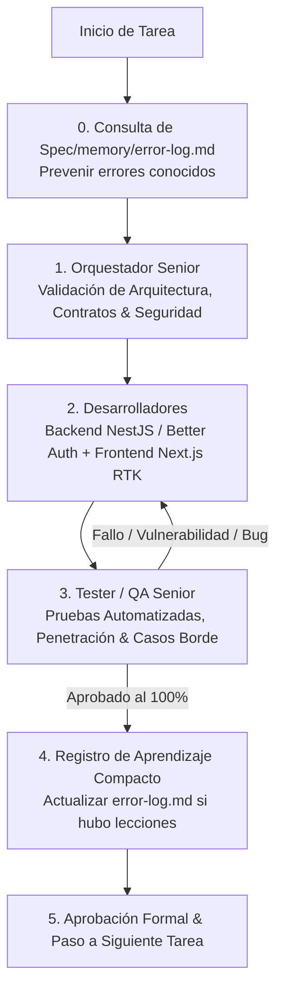

# Plan Maestro de Ejecución - Chifa Mariana SaaS

## 1. Principios Operativos del Equipo (Loop de Rectificación & Zero Token Waste)

Cada fase y tarea del proyecto se ejecuta bajo el ciclo cerrado de desarrollo y validación:

---

## 2. Cronograma Secuencial de Ejecución

### Fase 0: Aprovisionamiento de Seguridad, Secretos & Repositorio
* **Objetivo**: Configurar el perímetro de seguridad estricta antes de escribir lógica de negocio.
* **Acciones**:
  1. Configuración de **OpenBao** para proveer credenciales de base de datos y llaves en memoria (prohibición de `.env` planos).
  2. Inicialización de **Gitleaks** con hook pre-commit mediante Husky (`gitleaks protect --staged`).
  3. Creación del script de inicialización de MySQL con usuario de aplicación `chifa_app` bajo el **Principio de Menor Privilegio (PoLP)**: solo permisos `SELECT`, `INSERT`, `UPDATE`, `EXECUTE` (cero permisos DDL `DROP`/`TRUNCATE`).
* **Responsable**: Orquestador Senior y Desarrollador Backend.
* **Criterio de Salida**: `gitleaks` bloquea commits de prueba con secretos y MySQL rechaza comandos `DROP TABLE`.

---

### Fase 1: [Tarea 1] Fundaciones SaaS Multi-Tenancy, Better Auth & Gestión de Personal
* **Objetivo**: Establecer el Monolito Modular con aislamiento multi-inquilino y autenticación blindada.
* **Entregables**:
  1. **Backend**:
     - Estructura modular en NestJS (`core/openbao`, `core/database`, `modules/tenants`, `modules/users`).
     - `TenantContextInterceptor` con `AsyncLocalStorage` para inyectar automáticamente el filtro `tenant_id` en TypeORM (`synchronize: false` permanente, soft-deletes con `@DeleteDateColumn`).
     - Integración de **Better Auth** con plugin de Organizaciones.
     - Rate limiting estricto con `ThrottlerGuard` (máx 5 intentos / 5 min) y tiempo de respuesta constante contra *timing attacks*.
     - CRUD de trabajadores protegido exclusivamente para el rol `ADMIN` del tenant.
  2. **Frontend**:
     - SPA de autenticación en **Executive Precision Dark** (`#0B0F17`, `#131823`, `#2563EB`, `#10B981`, `#D97706`, `#757681`) con tipografía `Inter` y `JetBrains Mono`.
     - Configuración de **Redux Toolkit (RTK)** y **RTK Query** para `authSlice`.
     - Feedback táctil reactivo con principios de **Emil Kowalski** (`scale(0.97)` en botones, Sonner toasts).
     - SPA de gestión de trabajadores con modal reactivo.
* **Loop de Rectificación**: Tester ejecuta pruebas de aislamiento entre tenants (fuga de datos = 0), fuerza bruta (retorno de 429) y acceso restringido de personal no admin.

---

### Fase 2: [Tarea 2] Turnos de Caja Multi-Tenant & Motor de Sesión Atada al Turno
* **Objetivo**: Controlar la apertura/cierre de turnos y garantizar la persistencia de sesión durante el servicio.
* **Entregables**:
  1. **Backend**:
     - Entidad `shifts` vinculada al `tenant_id` con cálculo de ventana de gracia (`grace_expires_at = closed_at + 150 min`).
     - `ShiftBoundSessionGuard`: keep-alive automático para meseras, cocineros y cajeros en turno `OPEN`; revocación forzada a las 2.5 horas post-cierre.
     - `ShiftActiveGuard`: bloqueo con `412 Precondition Failed` si se intenta crear pedidos sin turno abierto.
     - Eventos de dominio `ShiftOpenedEvent` y `ShiftClosedEvent` en `EventEmitter2`.
  2. **Frontend**:
     - `shiftSlice` en RTK con estado `isShiftOpen` global.
     - Modal de apertura de turno con teclado numérico en fuente `JetBrains Mono`.
     - Badge pulsante de estado en el header (`#10B981` abierto / `#D97706` cerrado).
     - Modal de cierre y arqueo con desglose de totales esperados.
* **Loop de Rectificación**: Tester simula avance de tiempo para validar expiración tras 2.5h post-cierre y verifica el bloqueo inviolable de pedidos sin turno.

---

### Fase 3: [Tarea 3] Catálogo Jerárquico, Stock de Bebidas & Pantallas KDS Dinámicas (1..N)
* **Objetivo**: Permitir al Administrador crear pantallas de cocina y configurar el enrutamiento de platos, con despacho inmutable a caja.
* **Entregables**:
  1. **Backend**:
     - Entidades `kds_stations`, `categories`, `subcategories`, `products`, `inventory_movements`.
     - CRUD de pantallas KDS dinámicas por tenant (Pantalla 1, 2, 3, ..., N).
     - Enrutamiento de cada plato a su pantalla KDS asignada.
     - **Regla Inmutable**: `OrderDispatcherService` notifica siempre al WebSocket de Caja (`room:tenant_{id}:cashier`) en paralelo a las salas KDS (`room:tenant_{id}:kds_{stationId}`).
     - Descuento atómico de stock de bebidas y bloqueo por agotamiento.
  2. **Frontend**:
     - Panel de administración de catálogo con separación de Comidas y Bebidas.
     - Gestor visual de Pantallas KDS con paleta de colores distintivos.
     - Vista de Inventario de Bebidas con semáforo de existencias en `JetBrains Mono`.
     - SPA de Cocina KDS dinámica (`/kds/[stationId]`) con transiciones spring de Emil Kowalski y alertas sonoras.
* **Loop de Rectificación**: Tester envía comanda mixta y verifica la fragmentación exacta a cada pantalla KDS y la recepción íntegra en Caja.

---

### Fase 4: [Tarea 4] Comandero de Salón & Despacho Concurrente en Tiempo Real
* **Objetivo**: Dotar a las meseras de una herramienta táctil ultra rápida para emisión de pedidos.
* **Entregables**:
  1. SPA Comandero de salón (optimizado para móviles y tablets) con `cartSlice` en RTK.
  2. Buscador instantáneo de platos por nombre y subcategoría.
  3. Despacho instantáneo mediante WebSocket con reconexión automática y tolerancia a cortes de red.
* **Loop de Rectificación**: Pruebas de estrés y concurrencia con múltiples meseras emitiendo pedidos simultáneamente.

---

### Fase 5: [Tarea 5] Módulo de Cobranza, Arqueo de Caja & Auditoría Financiera
* **Objetivo**: Control financiero integral, cobranza y arqueos inmutables.
* **Entregables**:
  1. Terminal de Caja POS para cobro en Efectivo (cálculo de vuelto), Yape, Plin y Tarjetas.
  2. Pre-cuentas y emisión de comprobantes de pago.
  3. Cierre formal de turno con balance de arqueo y registro de discrepancias.
  4. Historial analítico de ventas por producto y consolidados por fecha/turno.
* **Loop de Rectificación**: Validación de cuadre de caja al centavo contra registros en MySQL.

---

### Fase 6: [Tarea 6] Aplicativo Móvil & Despliegue en Producción
* **Objetivo**: Empaquetado final y puesta en marcha en infraestructura cloud.
* **Entregables**:
  1. Aplicativo móvil empaquetado (PWA / React Native) para meseras.
  2. Orquestación completa con Docker Compose: NestJS Monolito, OpenBao, MySQL 8.0, Nginx con SSL y headers de seguridad.
  3. Documentación operativa y manual de despliegue en AWS / VPS.
* **Loop de Rectificación**: Auditoría final de seguridad y escaneo de vulnerabilidades previo al pase a producción.
