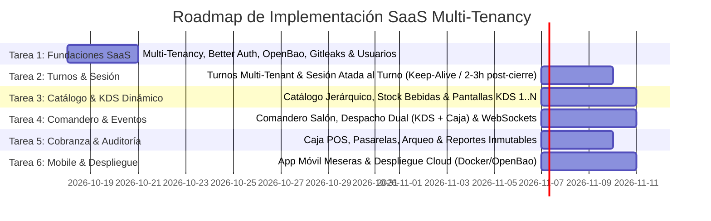

# Roadmap General del Proyecto SaaS - Chifa Mariana & Red Restaurantera

## 1. Visión Cronológica de Fases y Tareas

---

## 2. Detalle de Tareas del Proyecto SaaS

### Tarea 1: Fundaciones SaaS Multi-Tenancy, Better Auth y Gestión de Personal
- **Alcance**:
  - Aislamiento multi-inquilino en MySQL mediante discriminador `tenant_id` y `TenantContextInterceptor`.
  - Configuración de **Better Auth** con plugin de organizaciones para soporte SaaS.
  - Gestión de secretos en memoria con **OpenBao** (sin `.env` planos).
  - Escaneo preventivo de código y pre-commit hooks con **Gitleaks**.
  - Reglas anti-eliminación de BD (Zero Data Loss, soft-deletes, permisos MySQL sin DROP/TRUNCATE).
  - Gestión exclusiva de trabajadores por parte del `ADMIN` del tenant.

### Tarea 2: Turnos de Caja Multi-Tenant y Motor de Sesión Atada al Turno
- **Alcance**:
  - Entidad `shifts` vinculada al `tenant_id`.
  - Apertura de turno formal con fondo inicial de caja.
  - **Motor de Ciclo de Vida de Sesión (Shift-Bound Sessions)**:
    - *Turno Abierto*: Keep-alive automático de sesión para cajeros, meseras y cocineros; cero cierres de sesión involuntarios durante la jornada.
    - *Post-Cierre de Turno*: Conteo de ventana de gracia (2 a 3 horas post-cierre formal); revocación automática de todas las sesiones del tenant al cumplirse el tiempo.
  - Guard bloqueante `ShiftActiveGuard`: Rechazo inmediato (`412 Precondition Failed`) de cualquier pedido si la caja no tiene turno abierto.

### Tarea 3: Catálogo Jerárquico Multi-Tenant y Gestor Dinámico de Pantallas KDS
- **Alcance**:
  - Módulo administrativo de **Pantallas KDS Dinámicas**: El usuario/administrador crea libremente Pantalla 1, Pantalla 2, Pantalla 3, ..., Pantalla N.
  - Catálogo jerárquico de Comidas y Bebidas con variantes y tamaños.
  - Mapeo configurable de producto a pantalla(s) KDS designada(s).
  - **Regla Inmutable**: Todo pedido siempre se despacha a Caja, independientemente de la(s) pantalla(s) KDS asignadas.
  - Control de existencias estricto para gaseosas y bebidas con alertas de agotamiento.

### Tarea 4: Comandero de Salón y Despacho en Tiempo Real Basado en Eventos
- **Alcance**:
  - Interfaz de toma de pedidos para meseras (mesa o para llevar).
  - Emisión de `OrderCreatedEvent` en el event bus (`EventEmitter2`).
  - Despacho simultáneo vía WebSockets a la sala de Caja y a las salas específicas de cada pantalla KDS (`room:tenant_{id}:kds_{stationId}`).
  - Interfaces KDS dinámicas e independientes para cada estación de cocina creada.

### Tarea 5: Cobranza, Arqueo de Caja y Auditoría Financiera
- **Alcance**:
  - Cobro de pedidos en Caja (efectivo, Yape, Plin, tarjeta) y emisión de comprobantes.
  - Arqueo de cierre de turno comparando recaudación real vs calculada.
  - Historiales analíticos de ventas por producto y consolidados por turno para auditoría.

### Tarea 6: Aplicativo Móvil para Meseras y Despliegue en Producción
- **Alcance**:
  - App móvil táctil (React Native / PWA) para salón.
  - Orquestación con Docker Compose (NestJS, OpenBao, MySQL, Nginx con SSL) y aprovisionamiento en AWS o VPS.
