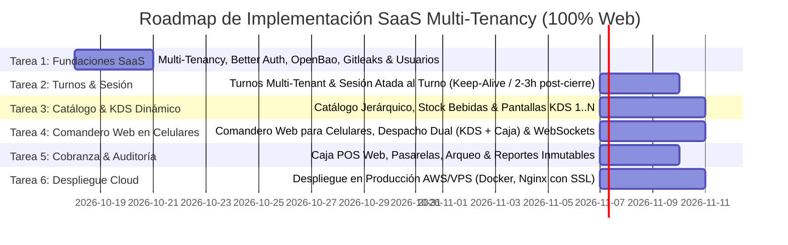

# Roadmap General del Proyecto SaaS - Chifa Mariana & Red Restaurantera (100% Web)

## 1. Visión Cronológica de Fases y Tareas

---

## 2. Detalle de Tareas del Proyecto SaaS

### Tarea 1: Fundaciones SaaS Multi-Tenancy, Better Auth y Gestión de Personal
- Aislamiento multi-inquilino en MySQL mediante discriminador `tenant_id` y `TenantContextInterceptor`.
- Better Auth con plugin de organizaciones y sesiones web seguras.
- Gestión de secretos en memoria con OpenBao y escaneo con Gitleaks.
- Reglas anti-eliminación de BD (Zero Data Loss, soft-deletes, permisos MySQL sin DROP/TRUNCATE).
- Gestión exclusiva de trabajadores por parte del `ADMIN` del tenant.

### Tarea 2: Turnos de Caja Multi-Tenant y Motor de Sesión Atada al Turno
- Apertura de turno formal con fondo inicial de caja.
- Motor de sesión web persistente: keep-alive en turno abierto; revocación automática a las 2 a 3 horas post-cierre.
- Guard bloqueante `ShiftActiveGuard`: Rechazo inmediato (`412 Precondition Failed`) de pedidos si no hay turno abierto.

### Tarea 3: Catálogo Jerárquico Multi-Tenant y Gestor Dinámico de Pantallas KDS
- Módulo de Pantallas KDS Dinámicas (Pantalla 1..N creadas por el usuario).
- Catálogo jerárquico de Comidas y Bebidas con variantes y tamaños.
- Enrutamiento de platos a pantallas KDS con **Despacho Inmutable a Caja**.
- Control de stock de bebidas y alertas de agotamiento.

### Tarea 4: Comandero Web para Celulares y Despacho en Tiempo Real
- **Comandero 100% Web**: Interfaz táctil ergonómica para celulares de meseras (sin app nativa).
- Despacho basado en eventos (`OrderCreatedEvent` vía `EventEmitter2`) y WebSockets hacia Caja y Pantallas KDS.

### Tarea 5: Cobranza, Arqueo de Caja y Auditoría Financiera
- Cobro en Caja web (Efectivo, Yape, Plin, Tarjetas), pre-cuentas y comprobantes.
- Arqueo de cierre de turno y reportes analíticos inmutables.

### Tarea 6: Despliegue en Producción Cloud (AWS / VPS)
- Orquestación con Docker Compose (NestJS, OpenBao, MySQL 8.0, Nginx con SSL).
- Puesta en marcha en infraestructura cloud y auditoría final de seguridad.
