# Tech Stack & Arquitectura SaaS - Chifa Mariana & Red Restaurantera

## 1. Patrón Arquitectónico Integral
La plataforma opera como un **SaaS Multinquilino** basado en un **Monolito Modular** en el backend (NestJS), clientes **Frontend Descentralizados (SPA)** construidos con **Next.js / React**, gestión de estado predecible con **Redux Toolkit (RTK/RTK Query)**, un diseño de élite basado en el sistema **Executive Precision Dark** con principios de interacción de **Emil Kowalski**, y comunicación en tiempo real basada en eventos.

```mermaid
graph TD
    subgraph Multi_Tenants [Empresas / Restaurantes Inquilinos]
        TENANT_A[Tenant A: Chifa Mariana]
        TENANT_B[Tenant B: Restaurante X]
    end

    subgraph Frontend_SPAs [Frontend Descentralizado - SPAs Executive Precision Dark]
        SPA_ADMIN[SPA 1: Caja / Admin / POS\nRTK Store + RTK Query]
        SPA_KDS[SPAs 2..N: KDS Dinámicas\nFeedback Táctil Emil Kowalski]
        SPA_MESERA[SPA Comandero Móvil\nJetBrains Mono para Precios/Tiempos]
    end

    subgraph Security_Vault [Seguridad Estricta & Secretos]
        OPENBAO[(OpenBao Secret Vault)]
        GITLEAKS[Gitleaks Scanner]
        BETTER_AUTH[Better Auth + Organizations Plugin]
    end

    subgraph Backend_Modular [Backend NestJS - Monolito Modular]
        TENANT_CTX[TenantContextInterceptor - AsyncLocalStorage]
        SESSION_GUARD[ShiftBoundSessionGuard\nKeep-Alive en Turno / Expiración 2-3h post-cierre]
        AUTH_MOD[Módulo Auth & Better Auth]
        USERS_MOD[Módulo Trabajadores por Tenant]
        SHIFTS_MOD[Módulo Turnos & Caja]
        CATALOG_MOD[Módulo Catálogo & Stock Bebidas]
        KDS_MOD[Módulo Pantallas KDS Dinámicas 1..N]
        ORDERS_MOD[Módulo Pedidos & Despacho Dual]
        
        EVENT_BUS[Event Bus Interno - EventEmitter2]
        WS_GATEWAY[WebSocket Gateway - Salas por Tenant y Pantalla]
    end

    subgraph Data_Layer [Persistencia Segura MySQL 8.0+]
        MYSQL[(MySQL InnoDB\nDiscriminador tenant_id\nUsuario sin DROP/TRUNCATE)]
    end

    subgraph Knowledge_Memory [Memoria de Aprendizaje Eficiente]
        ERROR_LOG[(Spec/memory/error-log.md\nRegistro Compacto sin Desperdicio de Tokens)]
    end

    OPENBAO -.->|Inyección en Memoria| Backend_Modular
    GITLEAKS -.->|Inspección Pre-Commit| Backend_Modular
    Frontend_SPAs <-->|HTTPS REST & WebSockets| Backend_Modular

    Backend_Modular --> TENANT_CTX
    TENANT_CTX --> SESSION_GUARD
    SESSION_GUARD --> MYSQL

    ORDERS_MOD -->|Emite OrderCreatedEvent| EVENT_BUS
    EVENT_BUS -->|Despacho Inmutable a Caja| WS_GATEWAY
    EVENT_BUS -->|Enrutamiento a Pantallas KDS 1..N| WS_GATEWAY
    EVENT_BUS -->|Descuento de Stock| CATALOG_MOD

    Backend_Modular -.->|Aprendizaje Continuo| ERROR_LOG
```

---

## 2. Pila Tecnológica Detallada

### 2.1. Frontend: Next.js, Redux Toolkit (RTK) y Emil Kowalski Principles
- **Framework**: **Next.js** (App Router, React 18/19, TypeScript).
- **Gestión de Estado**: **Redux Toolkit (RTK)** y **RTK Query**:
  - `shiftSlice`: Estado del turno activo, balance y sincronización de keep-alive.
  - `cartSlice`: Construcción atómica de comandas por mesa.
  - `kdsSlice`: Comandas en tiempo real agrupadas por estado (`PENDIENTE`, `PREPARANDO`, `LISTO`).
  - `RTK Query`: Caching optimista para catálogo, mesas y usuarios con revalidación en segundo plano.
- **Design System**: **Executive Precision Dark**:
  - **Canvas Background**: `#0B0F17` (Deep Slate Black).
  - **Card / Surface**: `#131823` con bordes `#20293A`.
  - **Surface Elevated**: `#1A2234` (modales y menús táctiles).
  - **Primary**: `#2563EB` (Royal Blue) para confirmaciones y estados activos.
  - **Secondary**: `#10B981` (Emerald Green) para turnos abiertos, cobros y platos listos.
  - **Tertiary / Accent**: `#D97706` (Amber) para platos en preparación y alertas de stock bajo.
  - **Neutral**: `#757681` (Slate Gray) para etiquetas secundarias.
  - **Textos**: Principal `#F8FAFC`, Secundario `#94A3B8`.
- **Tipografía**:
  - **Headline**: `Inter` (Font weight 600/700, tracking -0.02em).
  - **Body**: `Inter` (Font weight 400/500).
  - **Label / Métricas**: `JetBrains Mono` (Font weight 500/600) para montos (`S/ 38.00`), tiempos (`05:12 min`) y códigos.
- **Microinteracciones (Emil Kowalski)**:
  - Curvas de aceleración spring: `cubic-bezier(0.16, 1, 0.3, 1)`.
  - Presión táctil reactiva: `scale(0.97)` en botones en menos de 16ms.
  - Notificaciones flotantes suaves con **Sonner**.

### 2.2. Autenticación y Sesiones: Better Auth
- **Multi-Tenancy**: Plugin de organizaciones nativo; cada restaurante es una organización aislada.
- **Shift-Bound Sessions**:
  - *Turno Abierto*: Renovación automática de sesión (*keep-alive*) para todo el personal.
  - *Post-Cierre de Turno*: Cierre forzado e invalidación de sesiones a las **2 a 3 horas post-cierre** (`closed_at + 150 min`).
- **Seguridad Perimetral**: Rate limiting anti-fuerza bruta (5 intentos / 5 min), mitigación de timing attacks y cookies `HttpOnly`, `SameSite=Strict`, `Secure`.

### 2.3. Persistencia Segura: MySQL 8.0+ (Zero Data Loss)
- **Aislamiento Multi-Tenant**: Columna discriminadora `tenant_id` y `TenantContextInterceptor` con `AsyncLocalStorage`.
- **Regla Estricta Anti-Eliminación (PoLP)**:
  - Usuario de base de datos con permisos acotados: `SELECT`, `INSERT`, `UPDATE`, `EXECUTE`. Cero permisos `DROP`, `TRUNCATE`, `ALTER`.
  - Soft-deletes transversales con `deleted_at`.
  - TypeORM con `synchronize: false` permanente.

### 2.4. Pantallas KDS Dinámicas y Enrutamiento Inmutable
- El Administrador crea libremente **Pantalla 1, Pantalla 2, Pantalla 3... Pantalla N**.
- Cada plato se vincula a su pantalla KDS asignada.
- **Regla Inmutable**: Todo pedido se despacha obligatoriamente al terminal de **Caja**, en paralelo a su envío a las pantallas KDS seleccionadas.

### 2.5. Gestión de Secretos, Auditoría y Memoria Compacta
- **OpenBao**: Bóveda de secretos en memoria; cero archivos `.env` planos en producción.
- **Gitleaks**: Hook pre-commit con Husky y verificación en CI/CD.
- **Memoria de Aprendizaje Eficiente (Token-Efficient Error Memory)**:
  - Registro vivo en `Spec/memory/error-log.md` con estilo conciso para evitar errores pasados y optimizar el consumo de tokens.
