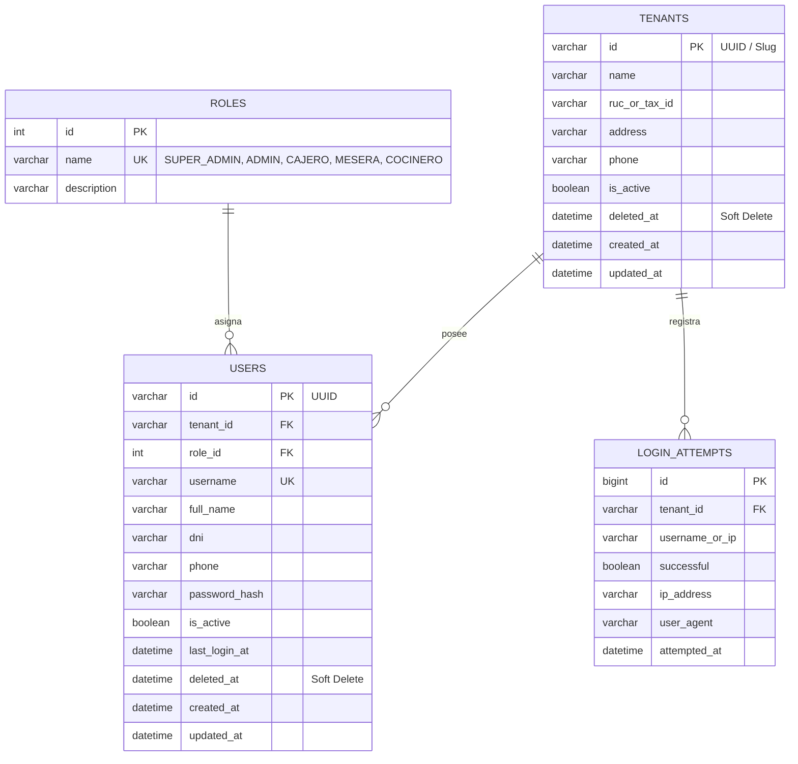

# Especificación Técnica - Tarea 1: Fundaciones SaaS Multi-Tenancy, Better Auth y Gestión de Personal

## 1. Resumen Ejecutivo
La Tarea 1 establece la arquitectura fundacional del SaaS Multinquilino utilizando **NestJS**, **Better Auth**, **OpenBao**, **Gitleaks** y **MySQL 8.0+**. Define el esquema de aislamiento estricto por inquilino (`tenant_id`), la regla de cero pérdida de datos con soft-deletes y permisos mínimos de base de datos, la autenticación blindada con Better Auth y el módulo de administración de personal exclusivo para el rol `ADMIN` de cada restaurante.

---

## 2. Requerimientos Funcionales (RF)

### RF-1: Aislamiento Multi-Tenancy (Organizaciones)
- **RF-1.1**: Cada restaurante opera como un inquilino independiente (`tenant_id`). Ningún usuario o consulta puede acceder o modificar datos de otro inquilino.
- **RF-1.2**: El contexto de inquilino se extrae de la sesión de Better Auth o del subdominio/cabecera `x-tenant-id` validada criptográficamente.
- **RF-1.3**: Roles soportados dentro de cada tenant:
  - `SUPER_ADMIN`: Administrador de la plataforma SaaS.
  - `ADMIN`: Administrador del tenant (único con permiso para gestionar trabajadores, cartas y KDS).
  - `CAJERO`: Personal de caja.
  - `MESERA`: Personal de salón.
  - `COCINERO`: Personal de cocina.

### RF-2: Autenticación con Better Auth
- **RF-2.1**: Gestión de sesiones seguras mediante Better Auth con plugin de organizaciones.
- **RF-2.2**: Hashing criptográfico de contraseñas con salting único por usuario.
- **RF-2.3**: Cookies de sesión protegidas (`HttpOnly`, `SameSite=Strict`, `Secure`).
- **RF-2.4**: Rate limiting perimetral para evitar ataques de fuerza bruta en login (máximo 5 intentos erróneos por 5 minutos antes de bloqueo temporal con respuesta `429 Too Many Requests`).
- **RF-2.5**: Respuestas en tiempo constante y mensaje genérico unificado ante errores de credenciales para mitigar *timing attacks*.

### RF-3: Gestión Exclusiva de Trabajadores por Tenant
- **RF-3.1**: El endpoint `/api/v1/users` solo puede ser invocado por el usuario con rol `ADMIN` del tenant activo. Los roles `CAJERO`, `MESERA` y `COCINERO` reciben `403 Forbidden`.
- **RF-3.2**: Cada trabajador creado se asocia automáticamente al `tenant_id` del administrador en sesión.
- **RF-3.3**: Los campos requeridos son: Nombre completo, DNI/Identificación, Teléfono, Rol, Nombre de usuario/correo, Contraseña, Estado (`ACTIVO` / `INACTIVO`) y `deleted_at` para borrado lógico.

---

## 3. Requerimientos de Seguridad y Persistencia (RNF)

### RNF-1: Regla Anti-Eliminación de BD (Zero Data Loss)
- **Principio de Menor Privilegio (PoLP)**: El usuario de MySQL `chifa_app` solo posee permisos `SELECT`, `INSERT`, `UPDATE` y `EXECUTE`. No tiene permisos `DROP`, `TRUNCATE`, `ALTER` ni `CREATE` en producción.
- **Soft-Deletes**: Todas las entidades de negocio implementan borrado lógico mediante la columna `deleted_at`.
- **TypeORM Synchronize Deshabilitado**: `synchronize: false` permanente.

### RNF-2: Gestión de Secretos con OpenBao
- Prohibición de archivos `.env` planos en entornos de producción.
- El servicio `OpenBaoVaultService` obtiene dinámicamente en memoria las credenciales de base de datos y llaves criptográficas de Better Auth durante el arranque (`bootstrap`).

### RNF-3: Inspección Preventiva con Gitleaks
- Hook pre-commit obligatorio con Husky (`gitleaks protect --staged`).
- Pipeline CI/CD que rechaza commits con secretos expuestos.

---

## 4. Modelo de Datos (MySQL Schema Multi-Tenant)

---

## 5. Criterios de Aceptación (DoD)
1. **Aislamiento Multi-Tenant**: Consultas ejecutadas por el Tenant A no pueden devolver registros del Tenant B.
2. **Seguridad de Better Auth**: Intentos de login fallidos repetidos activan el rate limiting con respuesta 429.
3. **Control Exclusivo de ADMIN**: Solo el `ADMIN` del tenant puede crear o editar trabajadores.
4. **Protección MySQL**: Comandos `DROP TABLE` o `TRUNCATE` son rechazados por denegación de privilegios en MySQL.
5. **Gitleaks & OpenBao**: Hooks activos y credenciales cargadas desde la bóveda OpenBao en memoria.
