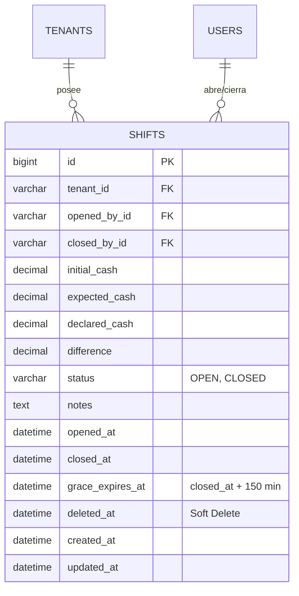

# Especificación Técnica - Tarea 2: Turnos de Caja Multi-Tenant y Motor de Sesión Atada al Turno

## 1. Resumen Ejecutivo
La Tarea 2 implementa el control de **Turnos de Caja Multi-Tenant** y el **Motor de Ciclo de Vida de Sesión Atada al Turno (Shift-Bound Sessions)**. Resuelve dos reglas operativas críticas de restaurantes:
1. **Regla de Sesión Persistente**: Mientras la caja esté abierta, ninguna sesión de mesera, cocinero o cajero puede caducar. Solo expirarán si el turno fue cerrado y transcurrieron entre 2 a 3 horas post-cierre.
2. **Regla de Bloqueo de Pedidos**: Prohibición dura de registrar pedidos en mesas o para llevar si no existe un turno abierto formalmente en el restaurante (`tenant_id`).

---

## 2. Requerimientos Funcionales (RF)

### RF-1: Gestión de Turnos por Tenant
- **RF-1.1 (Apertura de Turno)**:
  - Solo el usuario con rol `ADMIN` o `CAJERO` del tenant puede abrir un turno.
  - Endpoint: `POST /api/v1/shifts/open`
  - Body: `{ initialCash: number, notes?: string }`
  - Registra: ID del turno, `tenant_id`, usuario que abre (`opened_by_id`), fecha/hora de apertura (`opened_at`), fondo inicial en efectivo y estado `status = 'OPEN'`.
- **RF-1.2 (Unicidad de Turno Abierto)**:
  - Solo puede existir **un único turno con estado `OPEN` simultáneamente** por cada `tenant_id`. Intentos concurrentes son rechazados con `409 Conflict`.
- **RF-1.3 (Cierre de Turno y Arqueo)**:
  - Endpoint: `POST /api/v1/shifts/close`
  - Body: `{ declaredCash: number, notes?: string }`
  - Calcula el efectivo esperado por ventas registradas en el turno, calcula la discrepancia (`declaredCash - expectedCash`), registra fecha de cierre (`closed_at`), usuario que cierra y cambia el estado a `status = 'CLOSED'`.

### RF-2: Motor de Sesión Atada al Turno (Shift-Bound Session Lifetime)
- **RF-2.1 (Persistencia en Turno Abierto)**:
  - Mientras el tenant tenga un turno en estado `OPEN`, el middleware/interceptor de Better Auth ejecuta una renovación automática transparente (*Keep-Alive*) para todas las sesiones activas de los empleados (`CAJERO`, `MESERA`, `COCINERO`, `ADMIN`).
  - Ningún trabajador experimentará cierres de sesión involuntarios o tokens expirados durante el servicio.
- **RF-2.2 (Expiración Post-Cierre a las 2 a 3 Horas)**:
  - Cuando el turno cambia a `status = 'CLOSED'`, el sistema fija la marca de tiempo de caducidad de gracia: `gracePeriodExpiresAt = closed_at + 150 minutes` (2.5 horas).
  - Durante esa ventana de 2 a 3 horas, el personal puede finalizar revisiones y arqueos.
  - Al cumplirse las 2.5 horas desde `closed_at`, el interceptor invalida y revoca automáticamente todas las sesiones del tenant en Better Auth.
  - Cualquier petición posterior es rechazada con `401 Unauthorized` y el mensaje `"El turno anterior ha finalizado. Inicie sesión nuevamente para la nueva jornada."`

### RF-3: Regla Bloqueante de Pedidos (ShiftActiveGuard)
- **RF-3.1**: Cualquier endpoint de creación o modificación de pedidos (`/api/v1/orders`) está protegido por el guard `ShiftActiveGuard`.
- **RF-3.2**: Si no existe un turno con `status = 'OPEN'` para el `tenant_id` actual, la petición es rechazada de inmediato con HTTP `412 Precondition Failed`:
  ```json
  {
    "statusCode": 412,
    "error": "Precondition Failed",
    "message": "Operación bloqueada: La caja no tiene un turno abierto. Solicite al Administrador o Cajero la apertura de turno."
  }
  ```

---

## 3. Modelo de Datos (MySQL Schema de Turnos con Soft-Delete)



---

## 4. Criterios de Aceptación (DoD)
1. **Sesión Activa durante Turno**: Con el turno abierto, las sesiones de meseras y cocineros permanecen activas durante más de 8 horas continuas sin desconexión.
2. **Expiración a las 2-3h Post-Cierre**: Cerrado el turno formalmente, las sesiones se revocan automáticamente una vez vencida la ventana de gracia de 2.5 horas.
3. **Bloqueo Inviolable de Pedidos**: Con el turno cerrado, cualquier intento de emitir una orden responde `412 Precondition Failed`.
4. **Unicidad de Turno**: No es posible abrir dos turnos concurrentes para el mismo restaurante/tenant.
