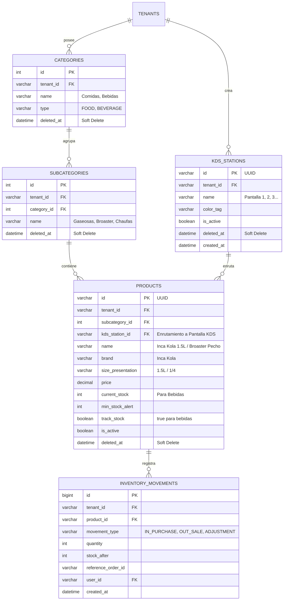

# Especificación Técnica - Tarea 3: Catálogo Jerárquico, Stock de Bebidas y Pantallas KDS Dinámicas

## 1. Resumen Ejecutivo
La Tarea 3 implementa el **Catálogo Jerárquico Multi-Tenant**, el **Control Estricto de Stock para Bebidas** y el **Gestor Dinámico de Pantallas KDS**. Permite que el Administrador de cada restaurante cree libremente sus pantallas de cocina (Pantalla 1, Pantalla 2, Pantalla 3... Pantalla N) y configure a qué pantalla se enruta cada plato o categoría de la carta, garantizando bajo una regla de negocio inmutable que **todo pedido siempre se envía en paralelo a la pantalla de Caja**.

---

## 2. Requerimientos Funcionales (RF)

### RF-1: Gestor Dinámico de Pantallas KDS (Cocinas Creadas por el Usuario)
- **RF-1.1 (CRUD de Pantallas KDS)**:
  - Solo el rol `ADMIN` del tenant puede crear, editar, reordenar y desactivar pantallas KDS.
  - Campos: `id`, `tenant_id`, `name` (ej. "Pantalla 1 - Chaufas y Caldos", "Pantalla 2 - Broaster y Hamburguesas", "Pantalla 3 - Bar y Bebidas"), `color_tag`, `is_active`, `deleted_at`.
- **RF-1.2 (Salas WebSocket Dedicadas)**:
  - Cada pantalla KDS creada tiene una sala de WebSocket aislada por tenant: `room:tenant_{tenantId}:kds_{stationId}`.
- **RF-1.3 (Acceso de Cocineros)**:
  - Los usuarios con rol `COCINERO` pueden tener asignada una o más pantallas KDS para operar su pantalla respectiva.

### RF-2: Catálogo Jerárquico Multi-Tenant
- **RF-2.1 (Estructura Jerárquica)**:
  - **Bebidas**: `Categoría (Bebidas) -> Subcategoría (Gaseosas, Aguas, Cervezas) -> Marca (Inca Kola, Coca Cola) -> Presentación/Tamaño (500ml, 1L, 1.5L, Gordita, Vidrio)`.
  - **Comidas**: `Categoría (Comidas) -> Subcategoría (Broaster, Chaufas, Caldos, etc.) -> Variedad/Tamaño (1/8, 1/4, 1/2, Entero, Mostrito)`.
- **RF-2.2 (Enrutamiento Configurable a Pantallas KDS)**:
  - Cada producto o subcategoría puede configurarse para dirigirse a una pantalla KDS específica (`kds_station_id`).
  - Si un producto es una bebida embotellada que no requiere preparación en cocina caliente, puede enrutarse a una "Pantalla de Bar" o despacharse directamente por la mesera.
- **RF-2.3 (Regla Inmutable de Despacho a Caja)**:
  - Independientemente de la(s) pantalla(s) KDS a las que se enrute un producto, **todos los ítems de cualquier pedido se registran y envían de forma obligatoria al terminal de Caja** para pre-cuenta y cobranza.

### RF-3: Control Estricto de Stock para Bebidas
- **RF-3.1 (Stock Físico Numérico)**:
  - Cada presentación de bebida almacena `current_stock` y `min_stock_alert`.
- **RF-3.2 (Descuento Atómico)**:
  - Al confirmarse un pedido, se descuenta de forma atómica el stock correspondiente en MySQL.
- **RF-3.3 (Bloqueo por Agotamiento)**:
  - Si `current_stock <= 0`, el comandero bloquea la adición del producto mostrando el badge visual `"AGOTADO"` e impidiendo la venta sin stock.
- **RF-3.4 (Kardex / Movimientos de Inventario)**:
  - Cada ingreso de mercadería o salida por pedido queda registrado en `inventory_movements` con timestamp y usuario responsable.

---

## 3. Modelo de Datos (MySQL Schema de Catálogo y KDS con Soft-Delete)

---

## 4. Criterios de Aceptación (DoD)
1. **Creación Libre de Pantallas KDS**: El Administrador puede crear N pantallas (Pantalla 1, Pantalla 2, Pantalla 3...) y asignarles nombre y color.
2. **Enrutamiento Correcto**: Un plato asignado a la "Pantalla 1" sólo emite evento a la sala WebSocket de la "Pantalla 1", mientras que los ítems van simultáneamente a Caja.
3. **Despacho Inmutable a Caja**: Ninguna orden puede crearse sin que su totalidad de ítems se refleje en el terminal de Caja.
4. **Protección de Stock**: No se permite agregar bebidas con stock 0 al comandero de meseras.
