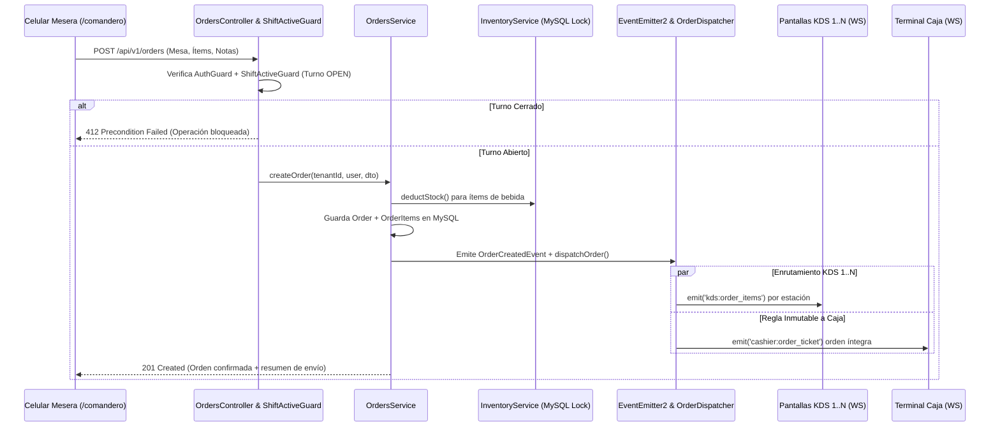

# Plan de Implementación Técnica - Tarea 4: Comandero Web para Celulares y Despacho Concurrente

## 1. Arquitectura de Módulos Backend (NestJS)

```
backend/src/modules/
├── orders/                               # Módulo de Pedidos y Comandas
│   ├── orders.module.ts
│   ├── orders.controller.ts              # Protegido con AuthGuard, ShiftBoundSessionGuard, ShiftActiveGuard
│   ├── orders.service.ts                 # Persistencia, stock atómico, EventEmitter2 y Despacho Dual
│   ├── orders.service.spec.ts            # Pruebas unitarias, concurrencia, 412 y multi-tenancy
│   ├── entities/
│   │   ├── order.entity.ts               # Con tenant_id y @DeleteDateColumn()
│   │   └── order-item.entity.ts          # Con tenant_id, kds_station_id y @DeleteDateColumn()
│   ├── dto/
│   │   ├── create-order.dto.ts
│   │   └── update-order-status.dto.ts
│   └── events/
│       └── order-created.event.ts        # Evento de dominio OrderCreatedEvent
└── kds/
    ├── kds.gateway.ts                    # Salas: kds_{stationId}, cashier y waiters por tenant
    └── order-dispatcher.service.ts       # Enrutamiento KDS 1..N + Regla Inmutable a Caja
```

---

## 2. Flujo de Creación y Despacho Concurrente de Comanda



---

## 3. Arquitectura Frontend 100% Web (`/comandero` + Redux Toolkit)

### 3.1. Slices de Estado Global (`frontend/src/store/slices/`)
- **`cartSlice.ts`**:
  - Estado: `tableNumber`, `orderType` (`DINE_IN` | `TAKEAWAY` | `DELIVERY`), `customerName`, `orderNotes`, `items` (`productId`, `name`, `price`, `quantity`, `notes`, `kdsStationId`, `kdsStationName`, `kdsStationColor`, `isBeverage`, `maxStock`).
  - Reducers atómicos con validación de límite de stock para bebidas.
- **`kdsSlice.ts`**:
  - Estado en memoria de comandas activas y notificaciones en tiempo real para sincronización entre pantallas.

### 3.2. Ergonomía Móvil y Microinteracciones (Executive Precision Dark + Emil Kowalski)
- **Paleta**:
  - Fondo Canvas `#0B0F17`, Tarjetas `#131823`, Superficie Elevada `#1A2234`, Bordes `#20293A`.
  - Primario `#2563EB`, Éxito `#10B981`, Alerta/Preparación `#D97706`, Texto Secundario `#94A3B8`, Muted `#757681`.
- **Tipografía**:
  - `Inter` para nombres de platos y encabezados.
  - `JetBrains Mono` (`font-mono`) obligatorio para precios (`S/ 24.50`), stock, códigos de orden (`#ORD-1001`) y tiempos.
- **Ergonomía Táctil a Una Mano**:
  - Botones de adición rápida `+` y `-` de mínimo `48px x 48px` con respuesta táctil `active:scale-[0.97]` y curva `cubic-bezier(0.16, 1, 0.3, 1)`.
  - Barra inferior fija al alcance del pulgar con apertura de *Bottom Sheet* para revisión de notas de cocina y confirmación de despacho.

---

## 4. Loop de Rectificación para Tarea 4
1. **Consulta Previa**: Verificar `Spec/memory/error-log.md` (extraer siempre `tenant_id` de la sesión, `synchronize: false`, despacho obligatorio a caja, cliente 100% web con botones >= 48px).
2. **Orquestador Senior**: Valida esquema `004-orders-schema.sql` con soft-deletes y contratos de API/WebSocket.
3. **Desarrolladores Backend & Frontend**: Implementan `OrdersModule`, `cartSlice`, `kdsSlice`, SPA `/comandero` y recepción en vivo en `/caja/turno`.
4. **Tester / QA Senior**: Ejecuta pruebas automatizadas de concurrencia, aislamiento multi-tenant, bloqueo `412` sin turno, agotamiento de stock y despacho dual.
