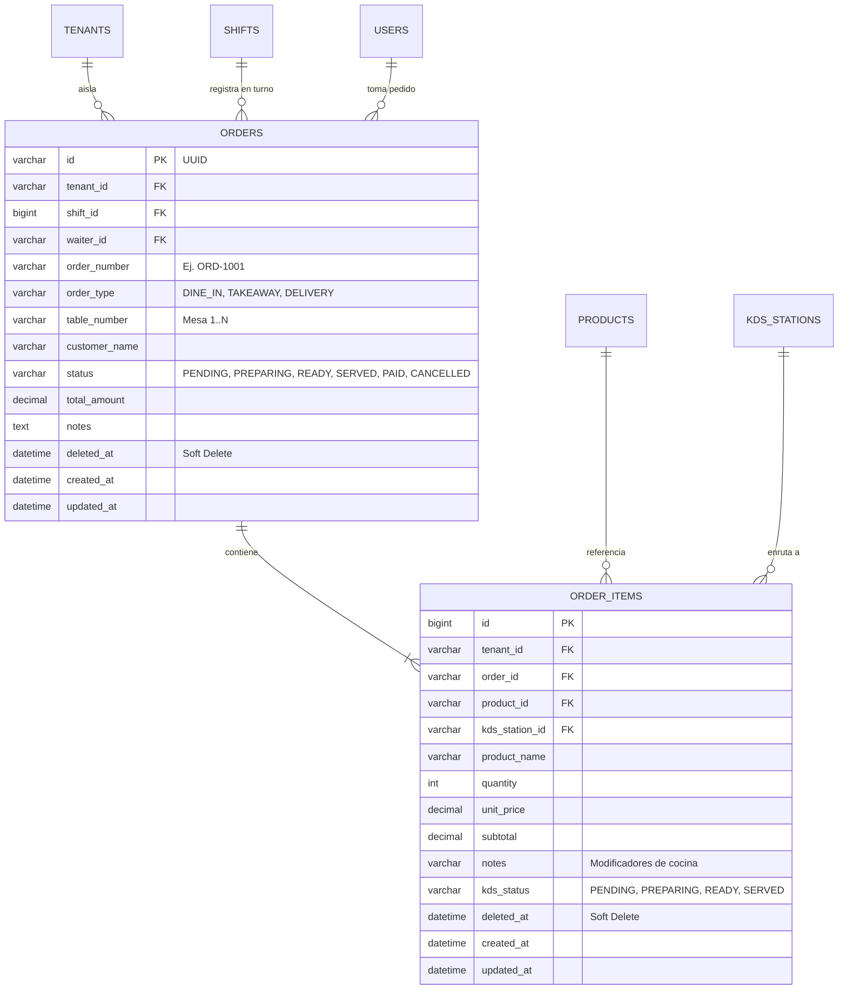

# Especificación Técnica - Tarea 4: Comandero Web para Celulares y Despacho Concurrente en Tiempo Real

## 1. Resumen Ejecutivo
La Tarea 4 implementa el **Comandero 100% Web para Celulares de Meseras (`/comandero`)** y el **Motor de Pedidos y Despacho Concurrente (`OrdersModule`)**. Diseñado bajo la arquitectura **100% Web Responsive (Zero Native Apps)**, permite que las meseras tomen pedidos a una sola mano desde cualquier navegador móvil (Android / iOS) con ergonomía táctil mínima de `48px`, buscador instantáneo, control de agotamiento de bebidas en tiempo real y despacho dual mediante `EventEmitter2` y WebSockets hacia las **Pantallas KDS Dinámicas (1..N)** y de forma **inmutable hacia el terminal de Caja**.

---

## 2. Requerimientos Funcionales (RF)

### RF-1: Comandero Táctil 100% Web para Celulares (`/comandero`)
- **RF-1.1 (Acceso Universal Móvil Web)**:
  - Interfaz 100% web construida en Next.js con **Executive Precision Dark** (`#0B0F17`, `#131823`, `#1A2234`, `#20293A`, `#2563EB`, `#10B981`, `#D97706`).
  - Botones de acción e incremento con área táctil mínima de `48px x 48px`, cero necesidad de zoom y operación fluida con el pulgar (Bottom Sheet de comanda).
- **RF-1.2 (Selector de Mesas y Modalidad de Pedido)**:
  - Selección rápida de modalidad: `Salón (DINE_IN)` con cuadrícula táctil de Mesas (`Mesa 1` a `Mesa 12`), `Para Llevar (TAKEAWAY)` y `Delivery (DELIVERY)`.
  - Visualización de qué mesas tienen pedidos activos en curso.
- **RF-1.3 (Buscador Instantáneo y Filtro por Categorías)**:
  - Barra de búsqueda instantánea en memoria (filtrado < 16ms sin recarga) por nombre de plato, bebida o descripción.
  - Filtros horizontales deslizables por categoría (`Todos`, `Chaufas`, `Tallarines`, `Broaster`, `Sopas`, `Bebidas`, etc.).
- **RF-1.4 (Carrito Reactivo en Redux Toolkit - `cartSlice`)**:
  - Adición, incremento, decremento y eliminación atómica de ítems en `cartSlice`.
  - Chips rápidos de notas de cocina por ítem (`"Sin cebolla"`, `"Poco ají"`, `"Bien frito"`, `"Sin sillao"`, `"Helada"`, `"Sin helar"`, `"Para llevar"`) más campo libre.
  - Bloqueo preventivo en UI si una bebida tiene `currentStock <= 0` (mostrando badge `"AGOTADO"`) o si la cantidad en carrito alcanza el stock disponible.

### RF-2: Motor de Pedidos Multi-Tenant y Protección de Turno (`OrdersModule`)
- **RF-2.1 (Aislamiento Multi-Inquilino Estricto)**:
  - El `tenant_id` y `waiter_id` se extraen exclusivamente del token de sesión verificado en `AuthGuard` (`req.user.tenantId`), ignorando cualquier intento de manipulación desde el cliente.
- **RF-2.2 (Bloqueo Inviolable sin Turno Abierto - `ShiftActiveGuard`)**:
  - El endpoint `POST /api/v1/orders` está protegido por `ShiftActiveGuard`. Si el restaurante no tiene un turno con `status = 'OPEN'`, rechaza inmediatamente la petición con `412 Precondition Failed`.
- **RF-2.3 (Transacción de Stock y Persistencia sin Borrado Físico)**:
  - Verifica la existencia y pertenencia de cada producto al `tenant_id`.
  - Ejecuta el descuento atómico de stock para bebidas mediante `InventoryService.deductStock()`.
  - Persiste la cabecera `orders` y el detalle `order_items` en MySQL con soporte de *Soft-Delete* (`deleted_at`).

### RF-3: Despacho Concurrente Basado en Eventos (`EventEmitter2` + WebSockets)
- **RF-3.1 (Emisión de `OrderCreatedEvent`)**:
  - Al confirmarse el pedido, `OrdersService` emite el evento de dominio `order.created` (`OrderCreatedEvent`) en el bus interno `EventEmitter2` e invoca `OrderDispatcherService`.
- **RF-3.2 (Enrutamiento Fragmentado a Pantallas KDS 1..N)**:
  - Cada ítem con `kds_station_id` asignado se envía en tiempo real a su sala exclusiva `room:tenant_{tenantId}:kds_{stationId}` mediante el evento `kds:order_items`.
- **RF-3.3 (Regla Inmutable de Despacho a Caja)**:
  - **Todo pedido completo**, incluyendo comidas de todas las estaciones y bebidas de despacho directo, se transmite obligatoriamente a la sala `room:tenant_{tenantId}:cashier` mediante el evento `cashier:order_ticket`.
- **RF-3.4 (Notificación de Retorno a Meseras)**:
  - Cuando cocina o caja actualiza el estado de una orden (`PREPARING`, `READY`, `SERVED`), se emite `order:status_updated` a las salas del tenant (`waiters` y `cashier`), alertando a la mesera en su celular con vibración/sonido y toast.

---

## 3. Modelo de Datos (MySQL Schema de Pedidos con Soft-Delete)

---

## 4. Criterios de Aceptación (Definition of Done - DoD)
1. **Ergonomía Móvil 100% Web**: El comandero `/comandero` opera en navegadores móviles con botones `>= 48px`, `JetBrains Mono` en todos los precios/códigos, feedback táctil `scale(0.97)` y cero layout shifts (`CLS = 0`).
2. **Bloqueo por Turno Cerrado (412)**: Ninguna comanda puede crearse si el turno de caja está cerrado (`412 Precondition Failed`).
3. **Despacho Concurrente Dual**: Al confirmar una comanda mixta desde el celular, se fragmenta instantáneamente a las Pantallas KDS configuradas y llega íntegra a la sala WebSocket de Caja.
4. **Control Atómico de Bebidas**: Si una bebida se agota (`currentStock === 0`), se bloquea tanto en el frontend como en el backend ante pedidos concurrentes.
