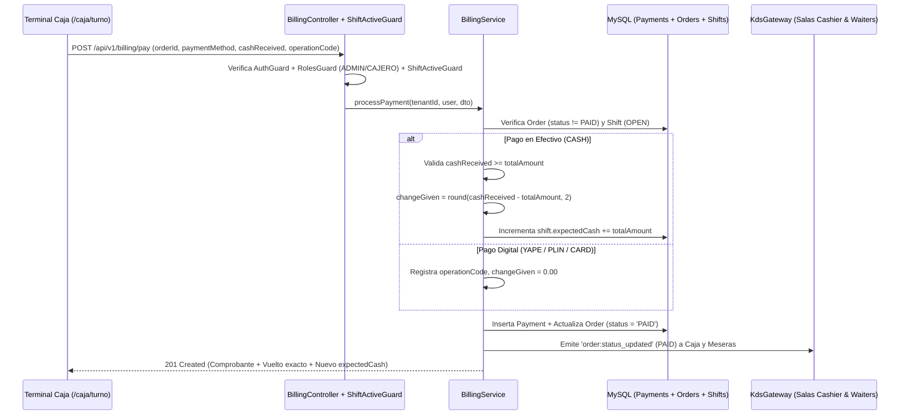

# Plan de Implementación Técnica - Tarea 5: Cobranza POS, Arqueo de Caja y Auditoría Financiera

## 1. Arquitectura de Módulos Backend (NestJS)

```
backend/src/modules/
├── billing/                              # Módulo de Cobranza, Pre-Cuentas y Auditoría Financiera
│   ├── billing.module.ts
│   ├── billing.controller.ts             # Endpoints /api/v1/billing/*
│   ├── billing.service.ts                # Cobro atómico, cálculo de vuelto, incremento de expectedCash y reportes
│   ├── billing.service.spec.ts           # Pruebas de cuadre al centavo, vuelto, doble cobro y multi-tenancy
│   ├── entities/
│   │   └── payment.entity.ts             # Entidad payments con tenant_id y @DeleteDateColumn()
│   ├── dto/
│   │   ├── create-payment.dto.ts
│   │   └── audit-filter.dto.ts
│   └── events/
│       └── order-paid.event.ts           # Evento de dominio OrderPaidEvent
└── shifts/
    ├── shifts.controller.ts              # Añade GET /api/v1/shifts/history
    └── shifts.service.ts                 # Historial de turnos y arqueos
```

---

## 2. Flujo Transaccional de Cobranza y Cuadre de Caja al Centavo



---

## 3. Arquitectura Frontend 100% Web (`Next.js 16` + `RTK Query` + `Executive Precision Dark`)

### 3.1. Terminal de Caja POS y Arqueo (`/caja/turno`)
- **Cola de Cobranza en Tiempo Real**:
  - Visualiza cada comanda pendiente de pago con botones táctiles para **Pre-Cuenta** y **Cobrar Comanda**.
- **Modal de Cobro Multi-Pasarela**:
  - Selector táctil (`min-h-[48px]`): `Efectivo`, `Yape`, `Plin`, `Tarjeta`.
  - Si es `Efectivo`: Botones rápidos de billetes (`Exacto`, `S/ 20`, `S/ 50`, `S/ 100`, `S/ 200`) y visualización prominente en `JetBrains Mono` del **Vuelto Exacto (`S/ XX.XX`)**.
  - Si es `Yape`, `Plin` o `Tarjeta`: Input en `JetBrains Mono` para el código de operación/referencia.
  - Selector de comprobante (`TICKET`, `BOLETA`, `FACTURA`) y vista de ticket emitido post-cobro.

### 3.2. Panel Ejecutivo de Auditoría Financiera (`/admin/auditoria`)
- **Filtros por Fecha y Turno**: Permite auditar cualquier jornada o turno específico.
- **KPIs Financieros en `JetBrains Mono`**: Ingresos Totales, Efectivo en Caja, Digital (Yape/Plin/Tarjeta), Ticket Promedio.
- **Ranking de Ventas por Producto**: Tabla ordenada por ingresos y unidades vendidas.
- **Auditoría de Arqueos de Turnos**: Historial inmutable con fondo inicial, efectivo esperado, efectivo declarado y discrepancias coloreadas (`#10B981` exacto, rojo faltante, `#2563EB` sobrante).
