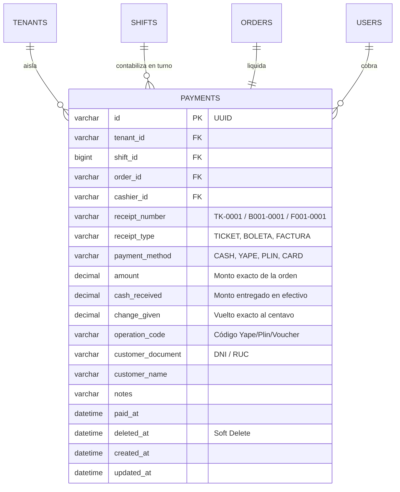

# Especificación Técnica - Tarea 5: Módulo de Cobranza, Arqueo de Caja y Auditoría Financiera

## 1. Resumen Ejecutivo
La Tarea 5 implementa el **Terminal de Cobranza POS en Caja Web**, el **Cierre Formal de Turno con Arqueo al Centavo** y el **Módulo de Auditoría Financiera e Historial Analítico de Ventas**. Permite cobrar comandas en **Efectivo** (con cálculo automático de vuelto e incremento atómico del efectivo esperado en gaveta), **Yape**, **Plin** y **Tarjetas** (con registro de código de operación en `JetBrains Mono`), emitir pre-cuentas y comprobantes (`TICKET`, `BOLETA`, `FACTURA`), y auditar ventas por producto y por turno de forma inmutable.

---

## 2. Requerimientos Funcionales (RF)

### RF-1: Cobranza Multi-Método en Caja Web (`/caja/turno`)
- **RF-1.1 (Métodos de Pago Soportados)**:
  - `CASH` (Efectivo): Requiere `cashReceived >= order.totalAmount`. Calcula de forma exacta al centavo `changeGiven = Number((cashReceived - totalAmount).toFixed(2))`.
  - `YAPE`, `PLIN`, `CARD`: Registra el código de operación/referencia (`operationCode`) en formato `JetBrains Mono` y fija `changeGiven = 0.00`.
- **RF-1.2 (Pre-Cuenta y Comprobantes)**:
  - Generación de **Pre-Cuenta** detallada de cualquier comanda activa antes del cobro.
  - Emisión de comprobante con numeración correlativa por tipo (`TICKET`, `BOLETA`, `FACTURA`) y registro opcional de DNI/RUC y nombre del cliente.
- **RF-1.3 (Impacto Exacto en Efectivo Esperado de Caja)**:
  - Únicamente los cobros realizados en `CASH` incrementan el `expected_cash` físico del turno activo (`expected_cash = initial_cash + SUM(pagos_efectivo)`), garantizando que el arqueo de billetes y monedas cuadre al centavo contra la gaveta física.
  - Los cobros por `YAPE`, `PLIN` y `CARD` se contabilizan de manera separada en el balance digital del turno.
- **RF-1.4 (Protección contra Doble Cobro y Caja Cerrada)**:
  - Protegido por `ShiftActiveGuard` (`412 Precondition Failed` si no hay turno abierto).
  - Si una orden ya tiene estado `PAID`, cualquier intento de cobro adicional se rechaza con `409 Conflict`.

### RF-2: Arqueo de Caja e Inmutabilidad de Cierre de Turno
- **RF-2.1 (Balance de Cierre de Turno)**:
  - Al cerrar el turno, el cajero/administrador visualiza:
    - Fondo inicial (`initial_cash`)
    - Total cobrado en Efectivo (`cash_sales`)
    - Efectivo esperado en gaveta (`expected_cash`)
    - Total cobrado por medios digitales (`YAPE`, `PLIN`, `CARD`)
  - Al ingresar el efectivo físico contado (`declared_cash`), el sistema registra la discrepancia exacta (`difference = declared_cash - expected_cash`) y activa la ventana de gracia de 2.5 horas (`grace_expires_at`).

### RF-3: Auditoría Financiera y Analítica de Ventas (`/admin/auditoria`)
- **RF-3.1 (Consolidado por Método de Pago y Fecha/Turno)**:
  - Reporte filtrable por fecha (`startDate`, `endDate`) o turno (`shiftId`) con totales recaudados, cantidad de transacciones y ticket promedio.
- **RF-3.2 (Ranking Analítico de Ventas por Producto)**:
  - Agregación exacta desde MySQL de unidades vendidas e ingresos generados (`S/`) por cada plato y bebida del catálogo.
- **RF-3.3 (Historial Inmutable de Arqueos de Turno)**:
  - Bitácora histórica de todos los turnos abiertos y cerrados del restaurante con sus discrepancias de caja (`S/ 0.00` cuadrada, faltante o sobrante) y operadores responsables.

---

## 3. Modelo de Datos (MySQL Schema de Cobranza con Soft-Delete)

---

## 4. Criterios de Aceptación (Definition of Done - DoD)
1. **Cuadre al Centavo**: El cálculo de vuelto (`cash_received - amount`), la suma de `expected_cash` en el turno y la diferencia de arqueo (`declared_cash - expected_cash`) operan con precisión decimal de 2 dígitos sin errores de punto flotante.
2. **Soporte Completo Efectivo, Yape, Plin y Tarjetas**: La terminal de Caja permite seleccionar cualquiera de los 4 métodos, calculando vuelto con botones de billetes rápidos en Efectivo o registrando el código de operación en pagos digitales.
3. **Inmutabilidad y Aislamiento Multi-Tenant**: Ningún pago puede eliminarse físicamente (`deleted_at` soft-delete) ni consultarse desde otro `tenant_id`.
4. **Reportes Analíticos**: La vista `/admin/auditoria` presenta ventas por producto, desglose por método de pago e historial de arqueos por turno.
