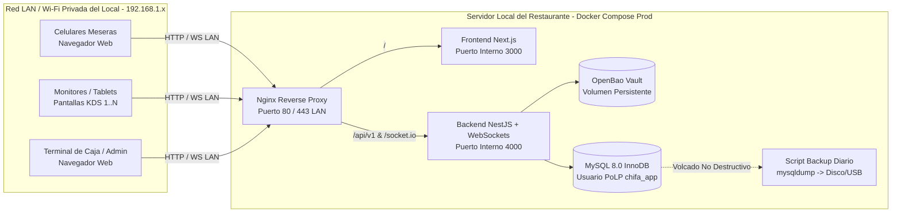

# Plan Técnico - Tarea 6: Despliegue en Servidor Local (On-Premise / LAN)

## 1. Arquitectura de Despliegue Local

---

## 2. Componentes a Implementar

1. **Orquestación de Producción Local (`infra/docker-compose.prod.yml`)**:
   - Servicios: `mysql`, `openbao`, `backend`, `frontend`, `nginx`.
   - Red privada interna `chifa_saas_network`.
   - Puertos de MySQL y OpenBao ligados exclusivamente a `127.0.0.1`.
2. **Reverse Proxy Local (`infra/nginx/nginx.conf`)**:
   - Enrutamiento de `/` hacia `frontend:3000`.
   - Enrutamiento de `/api/` y `/socket.io/` (con cabeceras `Upgrade` y `Connection "upgrade"` para WebSockets en tiempo real) hacia `backend:4000`.
3. **Respaldo Local Automatizado (`infra/scripts/backup-local.ps1`)**:
   - Ejecución de `mysqldump --single-transaction --routines --triggers` desde el contenedor `chifa_saas_mysql`.
   - Compresión con fecha/hora y limpieza de respaldos mayores a 30 días.
